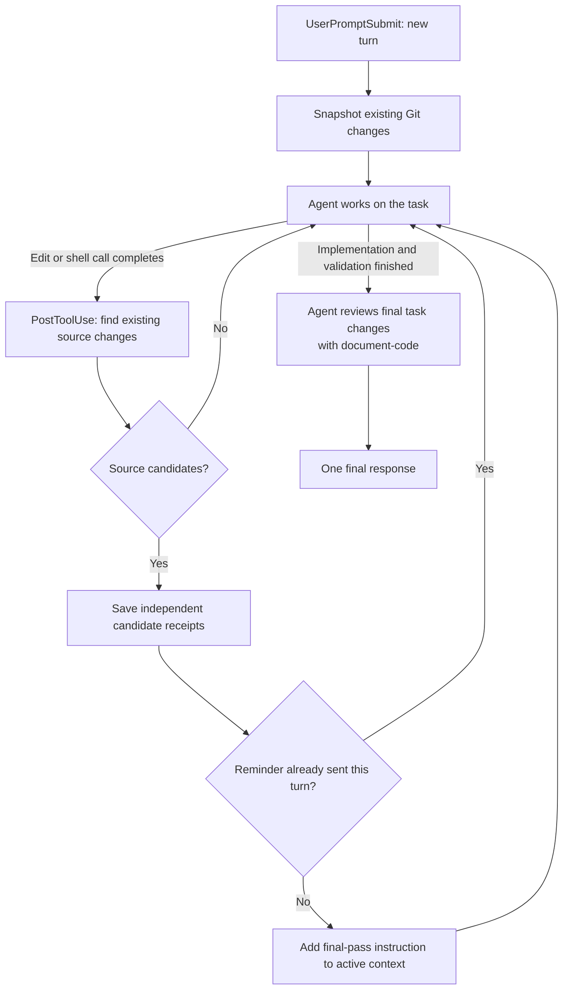

# Readable code

Before:

```js
function sendOverdueReminders(xs, n, send) {
  for (const x of xs) if (!x.paid && x.dueAtMs < n) send(x.email, x.balanceCents, Math.ceil((n - x.dueAtMs) / 86400000));
}
```

After:

```js
/**
 * Send a reminder for each unpaid invoice past its due time.
 *
 * @param {object[]} invoices - Invoice records; dueAtMs uses Unix milliseconds.
 * @param {number} nowMs - Current Unix time in milliseconds.
 * @param {Function} sendReminder - Called with (email, balanceCents, overdueDays).
 * @throws Propagates delivery failures and stops processing remaining invoices.
 */
function sendOverdueReminders(invoices, nowMs, sendReminder) {
  const millisecondsPerDay = 86_400_000;

  for (const invoice of invoices) {
    const isOverdue = !invoice.paid && invoice.dueAtMs < nowMs;
    if (!isOverdue)
      continue;

    const { email, balanceCents } = invoice;
    const overdueMs = nowMs - invoice.dueAtMs;

    // Count a partial overdue day as a full day when sending reminders.
    const overdueDays = Math.ceil(overdueMs / millisecondsPerDay);
    sendReminder(email, balanceCents, overdueDays);
  }
}
```

Two skills for code that people need to read:

| Skill | What it does | When it runs |
| --- | --- | --- |
| `readable-code` | Improves names, expressions, and control flow in selected code. | Only when explicitly requested. |
| `document-code` | Describes function contracts and explains complex reasoning. | When requested, or before the final response in coding turns with the Codex hooks enabled. |

Project instructions and enforced tooling take precedence. The readability preferences include meaningful intermediate variables, separate lines for control-flow bodies, guard clauses, and helper extraction. Documentation follows the project's existing standard, with language-specific fallbacks when none is established.

## Why readability is opt-in

Making each step explicit can produce more verbose code and use more output tokens. That extra detail is most useful when someone is about to read or debug the code. Apply `readable-code` as a focused pass when you need to understand a particular path; expanding every file by default can add detail nobody reads.

Controllers, entry points, and files that coordinate the main flow are useful starting points. Make their sequence of operations easy to follow from top to bottom, then use the function contracts maintained by `document-code` to understand the helpers they call. In an editor that displays documentation on hover, those contracts explain a function's purpose, inputs, results, and failures at the call site, reducing jumps into helper implementations.

## Install

The bundled hooks require Node.js 20 or newer on `PATH`. Git is needed to detect shell-based edits; direct edit tracking also works outside Git. There are no npm dependencies or separate model API calls.

### Skillshare

From a local checkout, preview and install the complete plugin:

```sh
skillshare plugin add . --plugin readable-code --target codex -g --dry-run --json
skillshare plugin add . --plugin readable-code --target codex -g --no-tui
```

After this repository is published, install from GitHub:

```sh
skillshare plugin add anthonyandrei/readable-code --plugin readable-code --target codex -g --dry-run --json
skillshare plugin add anthonyandrei/readable-code --plugin readable-code --target codex -g --no-tui
```

Use `plugin add` to keep hooks and skills together. Installing only the skill directories does not install the automatic reminder.

### Codex directly

From a local checkout:

```sh
codex plugin marketplace add .
codex plugin add readable-code@readable-code
```

For the published GitHub repository, replace the first command with:

```sh
codex plugin marketplace add anthonyandrei/readable-code
```

Restart or reload Codex as needed, enable the plugin, and review and trust its hooks through `/hooks`. Installation does not grant hook trust. Start a new coding turn after enabling the hooks so change tracking has a baseline.

This package uses a repository marketplace. Plugins containing lifecycle hooks are currently ineligible for the public plugin directory. See the official [plugin packaging guide](https://developers.openai.com/plugins/build/plugins) and [hook documentation](https://learn.chatgpt.com/docs/hooks).

## Use

```text
Use $readable-code on the functions changed in this task.
Use $readable-code on src/search.c, preserving its public interface.
Use $document-code to document the functions in this module.
```

With the plugin's hooks enabled, the first detected source change adds one reminder to the active turn's context: finish implementation and validation, then use `document-code` before the final response. The pass reviews the final implementation and treats comments written earlier in the task as drafts. Established project conventions refer to code that existed before the task. Project restrictions can place explanations in Markdown or another designated location, including notebooks that prohibit code comments and docstrings.

The skills can be used independently in other skill-capable agents. The automatic reminder is implemented for Codex; other hosts need their own integration or an explicit documentation request. The skills' invocation settings use Codex's `agents/openai.yaml` convention.

## Hook behavior and limits

With the plugin enabled and its hooks trusted:



- Each pass covers a coding turn, which may finish before the whole project. The agent filters unrelated external edits from candidates and checks documentation accuracy.
- The reminder uses `PostToolUse.additionalContext`. It relies on the agent following the instruction; there is no `Stop` hook to enforce another pass or create a continuation prompt.
- Request `$document-code` manually for shell-only edits outside the session's repository, shell-only edits to ignored files, or unrecognized [source extensions](hooks/document-code.cjs). Direct `Edit`, `Write`, and `apply_patch` events also cover recognized sources outside Git and in ignored paths.
- Tracking is local, with one context reminder per coding turn and silent candidate updates afterward. The agent reads the candidate receipts at review time and checks the final diff for surviving task-related changes. The review loads the skill and adds model work even if no documentation edits are needed. Its token cost varies.
- State under `PLUGIN_DATA` contains paths, hashes, and reminder markers, without source copies. Separate receipts preserve parallel edits. Tracking failures warn you to request a manual pass and allow the task to finish.

Disable the plugin to stop its hooks, or install the skills alone for manual use.

## Development

Run the focused hook checks with Node.js 20+ and Git:

```sh
node --test tests/document-code.test.cjs
node --test tests/plugin-loading.test.cjs
```

The hook tests use disposable repositories and hook data directories. The plugin loading test requires the Codex CLI and installs the package into a temporary Codex home to verify that both skills and the two tracking hooks appear. It does not execute the hooks or modify the user's Codex configuration.

`.codex-plugin/plugin.json` declares the skills and hooks; `.agents/plugins/marketplace.json` exposes this repository's plugin at its root. Codex 0.166.0 reports no hooks for this package with a root `plugin.json`, so use the Codex compatibility manifest until portable hook discovery works. Keep source paths inside the marketplace root and increment the manifest version when publishing an update.

## License

[MIT](LICENSE). Reuse, modification, redistribution, and sale are permitted subject to retaining the copyright and license notice.
